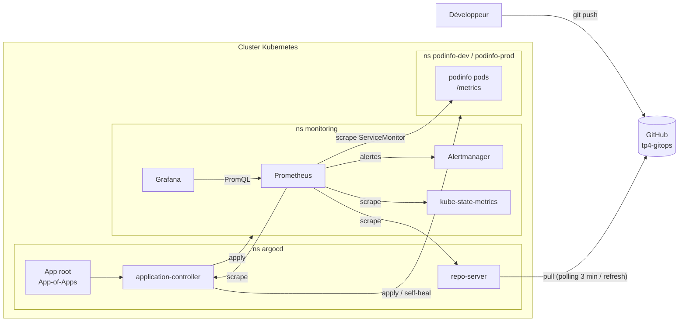

# TP4 — GitOps, ArgoCD et Observabilité (Prometheus & Grafana)

Ce dépôt est l'**unique source de vérité** (Single Source of Truth) du cluster :
l'application, la stack d'observabilité, les règles d'alerte et le dashboard Grafana
sont tous décrits de façon déclarative ici et déployés **par ArgoCD (modèle pull)**.

## 1. Architecture



- **Application** : [podinfo](https://github.com/stefanprodan/podinfo) (micro-service Go) qui expose
  nativement des métriques Prometheus (`http_request_duration_seconds`, …) sur le port `9797`.
- **ArgoCD** : installé une seule fois (bootstrap), puis tout le reste est piloté par le pattern
  **App-of-Apps** (`argocd/root-app.yaml` → `argocd/apps/*`).
- **Observabilité** : chart Helm `kube-prometheus-stack` déployé **par ArgoCD** (Application
  `kube-prometheus-stack`), et notre configuration (ServiceMonitors, PrometheusRule, dashboard)
  déployée par l'Application `monitoring-config`.

## 2. Structure du dépôt

```
tp4-gitops/
├── apps/podinfo/                 # Manifestes applicatifs (Kustomize)
│   ├── base/                     # Deployment, Service, ServiceMonitor communs
│   └── overlays/
│       ├── dev/                  # ns podinfo-dev, 2 réplicas, tag d'image
│       └── prod/                 # ns podinfo-prod, 3 réplicas, ressources plus grandes
├── argocd/
│   ├── root-app.yaml             # Application racine (seul fichier appliqué à la main)
│   └── apps/                     # Applications enfants (App-of-Apps)
│       ├── 00-projects.yaml      # AppProjects "platform" et "workloads" (moindre privilège)
│       ├── 10-monitoring-stack.yaml   # kube-prometheus-stack (Helm)
│       ├── 20-monitoring-config.yaml  # ServiceMonitors + alertes + dashboard
│       ├── 30-podinfo-dev.yaml
│       └── 31-podinfo-prod.yaml
└── monitoring/                   # Configuration d'observabilité (Kustomize)
    ├── argocd-servicemonitors.yaml
    ├── alert-rules.yaml          # PrometheusRule
    └── dashboards/gitops-overview.json   # Export JSON du dashboard Grafana
```

Les **sync-waves** (`-2` projets → `-1` stack monitoring → `0` config → `1` applications)
garantissent que les CRDs Prometheus existent avant la création des `ServiceMonitor`.

## 3. Choix techniques

| Choix | Justification |
|---|---|
| **Kustomize base/overlays** | Un seul jeu de manifestes, les différences par environnement (namespace, réplicas, tag, ressources) sont des patches déclaratifs. Pas de templating à maintenir. |
| **App-of-Apps** | Une seule commande de bootstrap ; ajout d'une app = ajout d'un fichier dans Git. Toute l'infra (y compris le monitoring) suit GitOps. |
| **`automated: {prune: true, selfHeal: true}`** | Déploiement continu sans intervention, suppression des ressources retirées de Git, correction automatique du drift. |
| **`progressDeadlineSeconds: 60`** | Une image invalide fait passer l'app en `Degraded` en 1 min (au lieu de 10) → détection rapide. |
| **`maxUnavailable: 0`** | Lors d'un déploiement raté, les anciens pods restent disponibles : pas d'interruption de service. |
| **ServerSideApply** pour kube-prometheus-stack | Les CRDs du Prometheus Operator dépassent la limite de taille de l'annotation `last-applied-configuration`. |
| **`*SelectorNilUsesHelmValues: false`** | Prometheus découvre tous les ServiceMonitors/PrometheusRules du cluster, sans label `release` obligatoire. |
| **Dashboard en ConfigMap** (`grafana_dashboard: "1"`) | Le dashboard est versionné dans Git et chargé automatiquement par le sidecar Grafana (*dashboards as code*). |

## 4. Métriques collectées

| Source | Endpoint | ServiceMonitor |
|---|---|---|
| ArgoCD application-controller | `argocd-metrics:8082` | `argocd-metrics` |
| ArgoCD API server | `argocd-server-metrics:8083` | `argocd-server-metrics` |
| ArgoCD repo-server | `argocd-repo-server:8084` | `argocd-repo-server-metrics` |
| kube-state-metrics, kubelet/cAdvisor, node-exporter | — | fournis par kube-prometheus-stack |
| podinfo | `podinfo:9797/metrics` | `podinfo` (dans `apps/podinfo/base`) |

## 5. Requêtes PromQL du dashboard

| Panneau | Requête |
|---|---|
| Sync Status de l'app | `argocd_app_info{name="$app"}` (légende `{{sync_status}}`) |
| Health Status de l'app | `argocd_app_info{name="$app"}` (légende `{{health_status}}`) |
| Apps par état de santé | `sum by (health_status) (argocd_app_info)` |
| Apps par état de sync | `sum by (sync_status) (argocd_app_info)` |
| Historique des syncs | `sum by (name, phase) (increase(argocd_app_sync_total[2m]))` |
| Nombre total de syncs | `sum(argocd_app_sync_total{name="$app"})` |
| Réconciliations / appels Git | `sum(rate(argocd_app_reconcile_count[5m]))`, `sum by (request_type) (rate(argocd_git_request_total[5m]))` |
| Pods Desired / Available / Unavailable | `sum(kube_deployment_spec_replicas{namespace="$namespace"})`, `sum(kube_deployment_status_replicas_available{…})`, `sum(kube_deployment_status_replicas_unavailable{…})` |
| Conteneurs en attente | `sum by (reason) (kube_pod_container_status_waiting_reason{namespace="$namespace"})` |
| CPU par pod | `sum by (pod) (rate(container_cpu_usage_seconds_total{namespace="$namespace", container!=""}[2m]))` |
| Mémoire par pod | `sum by (pod) (container_memory_working_set_bytes{namespace="$namespace", container!=""})` |
| Redémarrages | `sum by (pod) (increase(kube_pod_container_status_restarts_total{namespace="$namespace"}[10m]))` |
| Requêtes HTTP/s | `sum by (status) (rate(http_request_duration_seconds_count{namespace="$namespace"}[2m]))` |
| Taux d'erreurs 5xx | `sum(rate(…{status=~"5.."}[2m])) / sum(rate(…[2m]))` |
| Latence p95 | `histogram_quantile(0.95, sum by (le) (rate(http_request_duration_seconds_bucket{namespace="$namespace"}[2m])))` |
| Alertes | `sum by (alertname, alertstate) (ALERTS{alertname!="Watchdog"})` |
| Annotation « ArgoCD syncs » | `sum by (name, phase) (changes(argocd_app_sync_total{name="$app"}[1m])) > 0` |

## 6. Règles d'alerte (`monitoring/alert-rules.yaml`)

| Alerte | Expression | Durée |
|---|---|---|
| `ArgoCDAppDegraded` | `argocd_app_info{health_status="Degraded"} == 1` | 2 min |
| `ArgoCDAppOutOfSync` | `argocd_app_info{sync_status="OutOfSync"} == 1` | 2 min |
| `ArgoCDSyncFailed` | `increase(argocd_app_sync_total{phase=~"Error\|Failed"}[5m]) > 0` | — |
| `PodImagePullBackOff` | `kube_pod_container_status_waiting_reason{reason=~"ErrImagePull\|ImagePullBackOff"} == 1` | 1 min |
| `PodCrashLooping` | `kube_pod_container_status_waiting_reason{reason="CrashLoopBackOff"} == 1` | 2 min |

## 7. Bootstrap

```bash
kubectl create namespace argocd
kubectl apply -n argocd --server-side --force-conflicts \
  -f https://raw.githubusercontent.com/argoproj/argo-cd/v3.6.2/manifests/install.yaml
kubectl apply -f argocd/root-app.yaml
```

## 8. Sécurité et bonnes pratiques

- **Pull-based** : aucun pipeline CI n'a d'identifiants vers le cluster ; seul ArgoCD (dans le cluster) lit Git.
- **Moindre privilège** : AppProject `workloads` limité aux namespaces `podinfo-*` et sans ressource
  cluster-scoped (sauf `Namespace`) ; seul `platform` peut créer des CRDs/ClusterRoles.
- **Versions figées** : chart `93.9.0`, ArgoCD `v3.6.2`, image `podinfo:6.16.0` (jamais `latest`).
- **Conteneurs durcis** : `allowPrivilegeEscalation: false`, `capabilities.drop: [ALL]`, `seccompProfile: RuntimeDefault`, requests/limits.
- **Secrets** : aucun secret dans Git ; le mot de passe admin ArgoCD initial doit être changé puis le secret
  `argocd-initial-admin-secret` supprimé. En production : Sealed Secrets / External Secrets + SSO.
- **Limites / améliorations** : protection de branche + revue de PR sur `main`, Argo CD Image Updater,
  Argo Rollouts (canary piloté par les métriques Prometheus), notifications Alertmanager (Slack/email),
  ArgoCD géré lui-même par GitOps.
